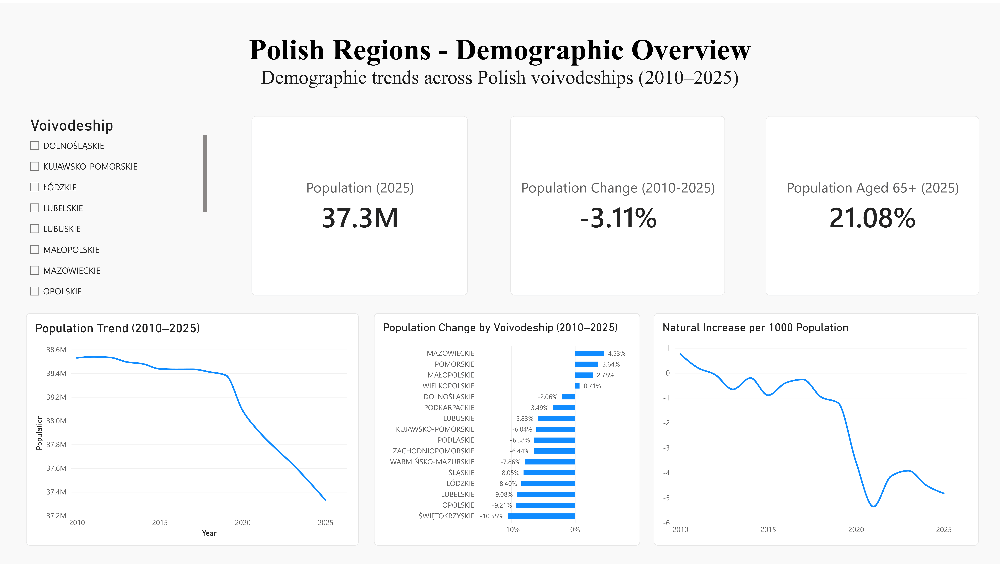
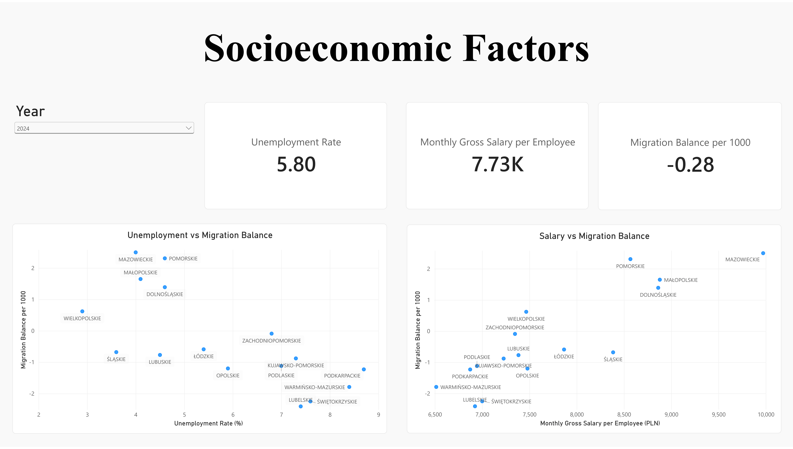

# Demographic & Economic Analysis of Polish Regions

## Project Overview

This project explores demographic changes and socioeconomic differences across all 16 Polish voivodeships between 2010 and 2025.

The main objective is to identify regional population trends and investigate whether unemployment, salary levels, and population ageing are associated with demographic changes.

The project combines data collection from a public API, data cleaning, exploratory data analysis (EDA), statistical hypothesis testing, and interactive Power BI dashboards.

## Research Questions

- How did population levels change across Polish voivodeships between 2010 and 2025?
- Which regions experienced the largest population decline or growth?
- How are unemployment rates and salary levels associated with migration?
- Is population ageing associated with long-term population decline?

## Data Source

**Statistics Poland (GUS) — Local Data Bank (BDL)**

API: https://bdl.stat.gov.pl/api/v1/

The dataset covers all 16 Polish voivodeships and contains annual observations for 2010–2025, where available.

The analysis includes:

- Total population
- Natural increase and natural increase per 1,000 inhabitants
- Migration balance and migration balance per 1,000 inhabitants
- Registered unemployment rate
- Monthly gross salary per employee
- Population aged 65+ and its share of total population

The final dataset contains **256 observations and 12 columns**.

## Tools and Technologies

| Technology | Purpose |
|---|---|
| Python | Data processing and analysis |
| Pandas, NumPy | Data cleaning and transformation |
| Requests | Data collection through the GUS BDL API |
| Matplotlib | Exploratory data visualization |
| SciPy | Pearson and Spearman correlation analysis |
| Power BI | Dashboard development and interactive visualization |
| Jupyter Notebook | Reproducible analysis workflow |

## Project Workflow

**Data Collection → Data Cleaning → Exploratory Analysis → Statistical Analysis → Power BI Visualization**

### Data Collection and Preparation

Data were retrieved from the GUS BDL API and combined into a regional panel dataset.

Data quality checks included missing-value inspection, duplicate detection, year coverage validation, and consistency checks across regional identifiers.

### Exploratory Data Analysis

The exploratory analysis examined regional population changes, demographic trends, natural increase, migration patterns, population ageing, unemployment, and salary differences.

### Statistical Analysis

Three hypotheses were investigated using Pearson and Spearman correlation coefficients.

| Hypothesis | Pearson r | Spearman ρ |
|---|---:|---:|
| Unemployment vs migration balance | -0.671 | -0.668 |
| Salary vs migration balance | +0.829 | +0.715 |
| Population ageing vs population change | -0.634 | -0.500 |

The first two rows use regional averages; the third compares long-term changes across the 16 voivodeships. These are associations, not causal estimates.

## Key Findings

- **12 out of 16 voivodeships** experienced population decline between 2010 and 2025.
- Mazowieckie recorded the largest relative population increase (+4.53%), while Świętokrzyskie experienced the largest decline (-10.55%).
- The share of residents aged 65+ increased in every voivodeship.
- Higher regional unemployment was associated with a less favorable migration balance.
- Higher nominal salary levels were associated with a more favorable migration balance.
- Regions with stronger population ageing tended to experience greater population decline.

## Power BI Dashboards

### Demographic Overview



The dashboard presents population trends, regional population changes, natural increase, and population ageing across Polish voivodeships.

### Socioeconomic Factors



The dashboard compares regional unemployment, nominal salary levels, and migration balance. The displayed view uses 2024, the latest common year available for these indicators.

## Project Structure

```text
polish_regions_data_analysis/
├── data/
│   └── processed/
│       └── polish_regions_analysis_ready.csv
├── notebooks/
│   ├── 01_data_collection.ipynb
│   ├── 02_data_exploration.ipynb
│   └── 03_statistical_analysis.ipynb
├── powerbi/
│   └── screenshots/
│       ├── demographic_overview.png
│       └── socioeconomic_factors.png
├── README.md
├── requirements.txt
└── .gitignore
```

## How to Run

Clone the repository and install the dependencies:

```bash
git clone https://github.com/plokijuuu/polish_regions_data_analysis.git
cd polish_regions_data_analysis
python3 -m pip install -r requirements.txt
```

Open the notebooks in Jupyter or VS Code and execute them in order:

1. `01_data_collection.ipynb` — retrieve and prepare the dataset.
2. `02_data_exploration.ipynb` — explore regional demographic and socioeconomic trends.
3. `03_statistical_analysis.ipynb` — test the research hypotheses.

Run the notebooks with the working directory set to `notebooks/` so the relative data paths resolve correctly.

## Limitations

- The analysis is observational and does not establish causality.
- Migration observations for 2015 are treated as missing.
- Registered unemployment data start in 2011, while salary data end in 2024.
- Salary values are nominal, are not inflation-adjusted, and represent the scope of the selected GUS indicator rather than the income of all residents.
- Population estimates are affected by changes in statistical methodology, including census-based revisions.
- Pooled region-year observations are not statistically independent; regional correlations are emphasized for interpretation.